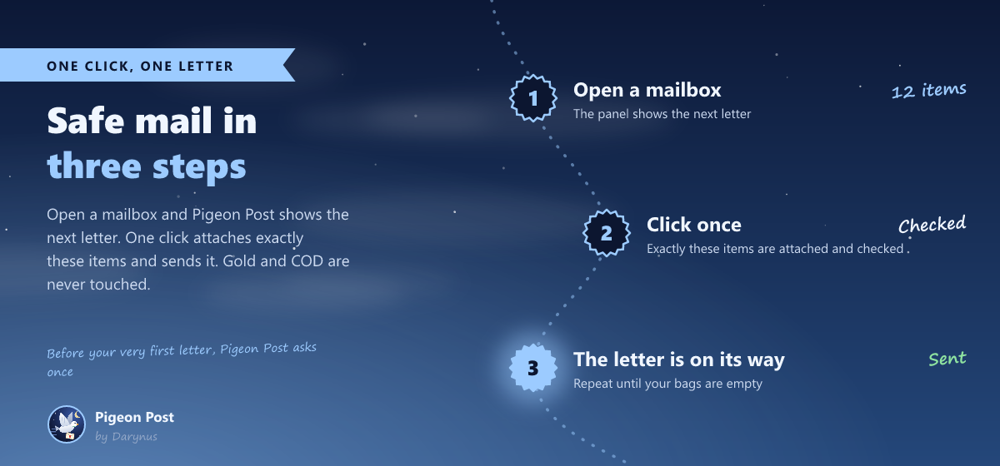
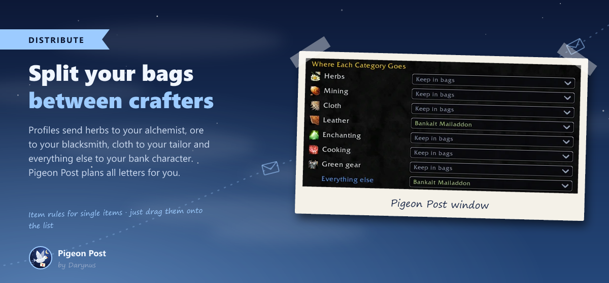
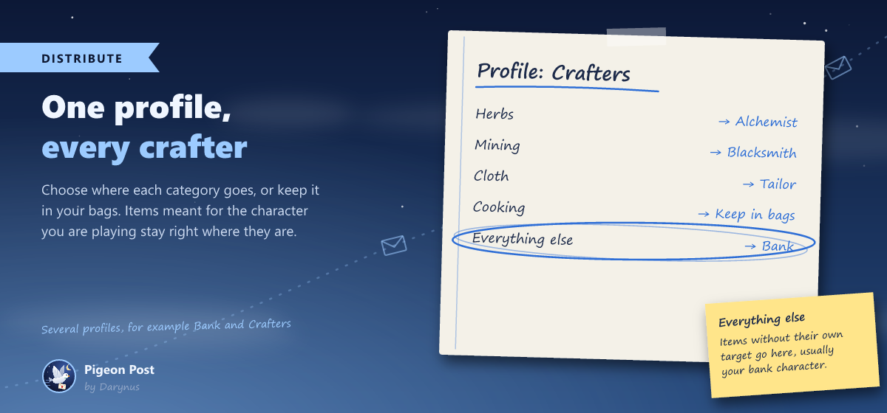
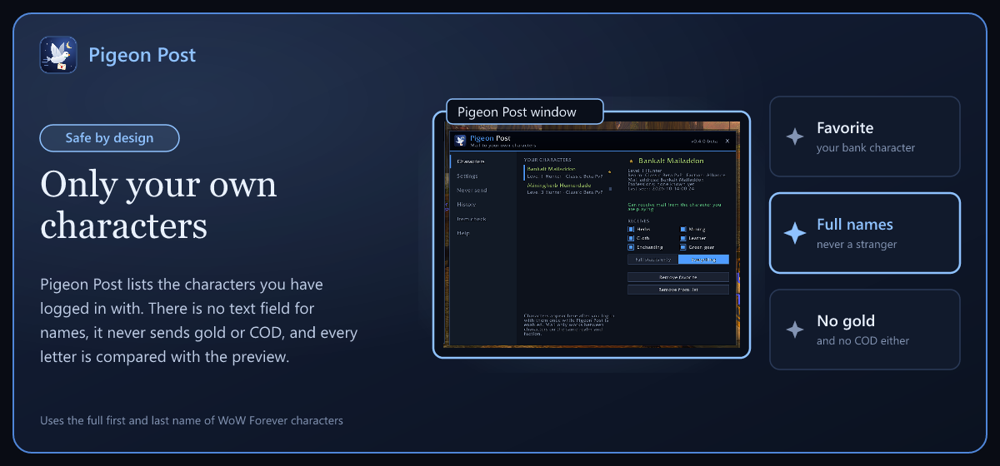

<h1 align="center">Pigeon Post</h1>

<b>Mail your gathered materials to your own characters, or split them between your crafters.</b> 
Safe, with a preview, one click per letter.

<a href="https://www.curseforge.com/wow/addons/pigeon-post">CurseForge</a> ·
<a href="CHANGELOG.md">Changelog</a> ·
<a href="https://github.com/Darynus/PigeonPost/issues">Report a bug</a>

> **Beta for WoW Forever.** Made for the Forever beta client 1.60.1.

You farm herbs and ore on one character, but your alchemist, blacksmith or bank character needs them? Open a mailbox, pick a character, click, and the letter is on its way. No typing names, no dragging twelve stacks by hand, no risk of mailing a stranger.

## New in 0.6

- **Looks like part of the game**: the Pigeon Post window and the mailbox panel now use the game's own window frame with a portrait, red buttons, checkboxes and radio buttons. The window has its tabs along the bottom.
- **Material icons** for every category, like copper ore for Mining or peacebloom for Herbs.

## New in 0.5

- **Distribute between your crafters**: herbs to your alchemist, ore to your blacksmith, cloth to your tailor, everything else to your bank character. Pigeon Post plans all letters, you send them one click at a time.
- **Item rules**: drag a single item onto the list and choose who gets it.
- **Simpler panel**: no more modes. The panel shows the next letter, one click sends exactly that. Pigeon Post asks once before your very first letter.
- **New category Cooking**: meat, fish, eggs and spices.

## Features

- **Panel next to the mailbox**: choose a recipient, choose what to send, see the next letter before it goes out.
- **Only your own characters**: Pigeon Post lists the characters you have logged in with. There is no text field for names.
- **Favorite recipient**: mark your bank character with a star. It is preselected on every character.
- **Categories**: Herbs, Mining, Cloth, Leather, Enchanting, Cooking and Green gear.
- **Full stacks only** or **everything**, **Never send** list, **history**, **item check** and a **tooltip line** with the category.
- **Works in every game language**: items are recognized by the game's own item data, never by names.

## Install

- **CurseForge app**: search for *Pigeon Post* under World of Warcraft, Forever.
- **By hand**: download the zip from CurseForge and put the `PigeonPost` folder into `World of Warcraft\_classic_beta_\Interface\AddOns`. Restart the game.

## Commands

| Command | What it does |
|---|---|
| `/pigeon` | open or close the Pigeon Post window |
| `/pigeon panel` | show or hide the panel at the mailbox |
| `/pigeon split` | switch between one character and Distribute |
| `/pigeon profile <name>` | choose a distribution profile |
| `/pigeon favorite <name>` | set or remove a favorite recipient |
| `/pigeon remove <name>` | remove a character from your list |
| `/pigeon log` | show the last letters in chat |
| `/pigeon check` | open the item check |
| `/pigeon help` | list all commands |

## Safety

- It **never sends gold or COD**. If there is money in the mail window, it stops.
- It only mails characters **from your own list**, on **your realm and faction**, with their **full first and last name**.
- **One click sends at most one letter.** Nothing happens on its own when you open a mailbox.
- **You only send what you saw**: every attachment is compared with the preview before the letter goes out.
- Soulbound items, quest items, bags and items on your *Never send* list are never touched.

## Support

Made by a gamer, for gamers. Pigeon Post is free and always will be.

Bug reports and ideas are welcome in the [issues](https://github.com/Darynus/PigeonPost/issues) or in the CurseForge comments.
